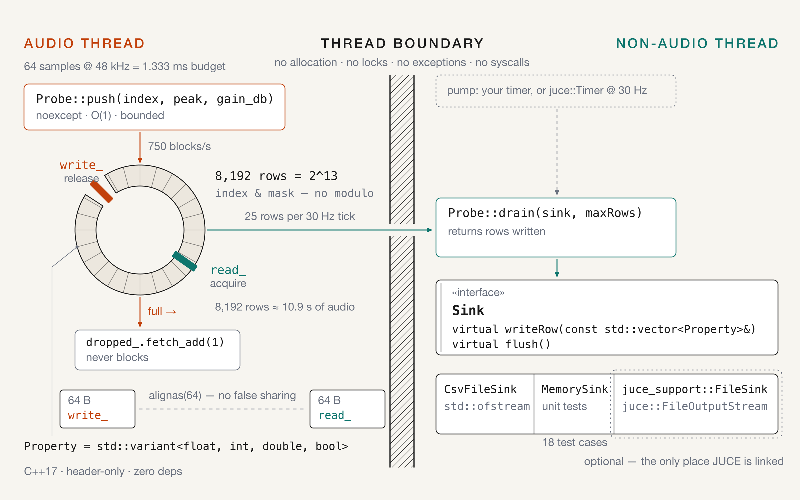

# dsp-probe

**You can't printf from the audio thread.**

A 64-sample block at 48 kHz gives you 1.333 ms, and nothing you would use to look
inside a DSP fits in that window. So the numbers have to leave through a lock-free
queue — and that hand-off, not the logging, is the engineering problem.

Header-only C++17, zero dependencies. Extracted from **RaiderPro**, a commercial
audio plugin, where it ran inside the DSP functional tests before being made
standalone.

`C++17` · `header-only` · `zero deps` · `MIT`



*The audio thread writes, another thread drains. Nothing crosses the boundary
except the ring, and a row that does not fit leaves through the counter on the
left rather than blocking.*

## Throughput and sizing

Every number in this section follows from one: at 48 kHz a 64-sample block lasts
**1.333 ms**.

| Quantity | Value |
|---|---|
| Blocks per second | 48,000 / 64 = **750** |
| Rows per second | one `push()` per block = **750** — columns do not change the row count |
| Rows per tick, draining at 30 Hz | 750 / 30 = **25** |
| Ring capacity | 8,192 rows (2^13) |
| Headroom, 750 rows/s | 8,192 / 750 = **10.9 s of audio** |

In steady state a 30 Hz drain moves 25 rows out of a ring that holds 8,192, so the
ring sits at about **0.3 % per tick** and never fills on its own. That is the point
that is easy to misread: **the ring is not a throughput buffer, it is a stall
buffer.** It absorbs the case where the draining thread does not run — blocked on
disk, starved by the scheduler, parked at a breakpoint — while the audio thread
keeps pushing. 8,192 rows is roughly 10.9 seconds of that before the ring is full.

So the sizing rule is stated rather than implied:

```
capacity  >=  rows_per_second  x  longest_stall_you_accept
```

rounded up to a power of two. The 8,192 default assumes 48 kHz with 64-sample
blocks and one row per block. The same capacity covers **87 s** at 512-sample
blocks (93.75 rows/s) and only **2.7 s** at 3,000 rows/s (four rows per block at 64
samples) — so the default is a choice about that operating point, not a universal
figure.

What happens when the ring runs out:

Waiting is not an option. Waiting spends the block budget, and the budget *is* the
deadline. So `push()` **drops the incoming row and counts it**. Dropping on write
keeps everything already queued ordered and intact, and `test_probe.cpp` asserts
exactly that: the survivors are the oldest rows, not a corrupted mix.

The count is what keeps the output honest. A probe that loses rows silently turns
a test that passes into a test that lies, which is why `dropped()` ships with the
policy instead of as an afterthought.

Every line of `push()` is bounded: `noexcept`, no allocation, no locks. Memory
happens in the constructor or not at all.

## Implementation choices, and what each one costs

- **8,192 rows = 2^13** — `index & mask` instead of a modulo, allocated once; the
  size is the stall budget from above, not a tuning knob
- **One producer thread** — a second audio thread would need the lock the design avoids
- **`alignas(64)` on `read_` and `write_`** — producer and consumer never share a cache line
- **`std::variant<float, int, double, bool>`** — a closed column set, rejected at the call site by a `static_assert`
- **A `Sink` interface** — `std::ofstream` in the core, JUCE confined to one optional adapter
- **18 test cases, 86 assertions** — index wrap, drops at capacity, arity, `maxRows` batching

## The hot path

```cpp
// AUDIO THREAD. No allocation, no locks, no exceptions, bounded time.
template <typename... Args>
void push(const Args&... args) noexcept
{
    static_assert((is_property_type_v<Args> && ...),
                  "Probe columns accept only float, int, double or bool");

    if (!running_.load(std::memory_order_acquire))
        return;

    const auto writeIndex = write_.load(std::memory_order_relaxed);
    const auto readIndex  = read_.load(std::memory_order_acquire);

    if (writeIndex - readIndex >= capacity_) {          // full: drop, and count it
        dropped_.fetch_add(1, std::memory_order_relaxed);
        return;
    }

    Row& slot = rows_[writeIndex & mask_];
    std::size_t i = 0;
    ((slot[i++] = Property{args}), ...);                // fold over the columns

    write_.store(writeIndex + 1, std::memory_order_release);
}
```

```cpp
// NON-AUDIO THREAD. Any timer will do.
probe.drain(sink);

// When the test ends:
probe.stop(sink);                // disarm + drain the remainder
assert(probe.dropped() == 0);    // if this fails, the CSV is missing rows
```

## Getting started

```cmake
include(FetchContent)
FetchContent_Declare(dsp-probe
  GIT_REPOSITORY https://github.com/Diegorandom/dsp-probe.git
  GIT_TAG main)
FetchContent_MakeAvailable(dsp-probe)

target_link_libraries(your_test PRIVATE dsp_probe::dsp_probe)
```

```cpp
#include "dsp_probe/csv_file_sink.hpp"
#include "dsp_probe/probe.hpp"

dsp_probe::Probe probe({"block", "peak", "gain_reduction_db"}, 512);
dsp_probe::CsvFileSink sink("limiter.csv", probe.columns());
probe.start();

probe.push(blockIndex, peak, gainReductionDb);   // audio thread
probe.drain(sink);                               // any other thread
```

`drain()` writes to any `Sink`. `MemorySink` keeps rows in memory, so a unit test
can assert on what a probe produced without touching a filesystem.

## API

| Member | Thread | Notes |
|---|---|---|
| `Probe(columns, capacity)` | any | Allocates everything. Capacity rounds up to a power of two (8192 default) |
| `start()` / `stop()` | any | `push()` is inert until `start()` |
| `push(args...)` | **audio** | `noexcept`. Wrong arity counts as a drop, never writes a short row |
| `drain(sink, maxRows)` | non-audio | Returns rows written |
| `stop(sink)` | non-audio | Disarms, drains the remainder, flushes |
| `dropped()` / `pending()` | any | Rows lost; rows queued |

Floating point is written with **6 decimals**, matching what the original plugin
logger produced, so reference CSVs stay comparable across the migration.

## Where it came from

This is the `CSVLogger.h` that **RaiderPro** used in its DSP functional tests,
extracted into a standalone, testable library. The behaviour was proven in the
plugin before the extraction; what is new here is the packaging:

| Original (inside the plugin) | Here |
|---|---|
| `juce::AbstractFifo` + a parallel vector of rows | `Probe`: one SPSC ring, acquire/release on the indices |
| `#if JUCE_DEBUG` around everything | **removed** — a library that silently no-ops is how you end up debugging a test that never logged |
| `juce::FileOutputStream` only | a `Sink` seam: `std::ofstream` in the core, JUCE in the adapter |
| `juce::Timer` owned by the logger | `drain()` you call from your own timer — the timer is a client, not part of the library |
| CSV escaping, drop counter, header-once | **kept**, and now covered by tests |

**JUCE is optional.** It is confined to one adapter header —
`dsp_probe::juce_support::CsvLogger` — which keeps the exact original API
(`start()`, `pushFromAudioThread()`, `getDroppedRowCount()`, …), so an existing
call site needs no changes. The core has no JUCE dependency at all, which is why
the tests run without a plugin host.

## Verified, not asserted

```bash
cmake --preset debug && cmake --build --preset debug && ctest --preset debug
```

- **86 assertions across 18 test cases**, covering the parts of a lock-free ring
  buffer that actually break: index wrap-around, dropping at capacity (and that
  the survivors are the *oldest*), arity mismatch, `maxRows` batching, and a
  disarmed probe ignoring `push()` without counting it as a drop.
- **ASan + UBSan** via `--preset asan`.
- **CI** on Linux (gcc and clang) plus a sanitizer job, on every push. macOS,
  Windows and the JUCE compile check are manual jobs on purpose: runners cost 1×
  on Linux but ~1.7× on Windows and ~10× on macOS, against a 2,000 min/month
  private-repo quota.

## What is not solved

Declared, not hidden:

- **Row layout is a vector of vectors.** One heap allocation per slot at
  construction and a pointer chase per drained row. A flat buffer would be one
  allocation and contiguous; it is declared rather than fixed because the cost
  lands on construction and on the draining thread, never on the audio thread.
- **`dropped()` is a total, not a timeline.** It says how many rows were lost and
  not when, so it cannot localise an overload to a block.
- **The extracted adapter has not been compiled in this repository yet.** Its
  behaviour is the plugin's proven behaviour; the extraction is new code. The JUCE
  CI job is its first real compile.
- **Number formatting follows the process locale** until something calls
  `std::setlocale(LC_NUMERIC, …)`; a comma-decimal locale would corrupt the CSV.
- **CSV injection is not neutralised.** A field starting with `=` is still
  evaluated as a formula by a spreadsheet. Sanitising here would mutate the data
  the library exists to record faithfully.

## License

MIT — see [LICENSE](LICENSE).
